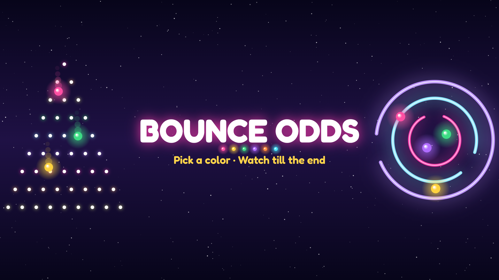

# Posts automáticos: Bounce Odds

Anotações do que já está pronto e do que falta para os vídeos saírem sozinhos no **TikTok** e no **YouTube Shorts**.

## O que já funciona

- **Todo dia às 8h (Brasília)**, o workflow [Vídeo do dia](.github/workflows/diario.yml) gera um vídeo novo no GitHub, mesmo com o PC desligado.
  - A simulação segue um rodízio (pista → labirinto → zona → plinko → corrida). A música, as cores, o fundo e o gancho variam pela data: a mesma data sempre gera as mesmas escolhas.
  - Ele busca uma seed com bom final e boa duração (na pista, metade dos dias tem "drama", com metade ou mais das bolinhas eliminadas).
- Cada vídeo vira uma **Release** do repositório, com:
  - o MP4 (1080×1920, H.264 + AAC) num **link público**;
  - `legenda.txt` com a legenda em inglês e as hashtags;
  - `info.json` com as escolhas do dia (simulação, seed, música, resultado).
- Primeiro vídeo gerado: [video-2026-10-16-2](https://github.com/finder96/bolas/releases/tag/video-2026-10-16-2).
- **Gerar fora do horário:** *Actions → Vídeo do dia → Run workflow*. Dá para escolher a simulação.
- **Gerar no PC:** `npm install` uma vez e depois `npm run diario` (opções: `-- --sim pista`, `-- --data 2026-10-20`). O vídeo sai em `out/`.

### Como funciona por dentro

| Peça | O que faz |
|---|---|
| `public/auto.js` | Gera um vídeo completo sem interface (`window.quica.auto`) |
| `scripts/diario.mjs` | Sobe o servidor, abre o Quica num Chrome invisível (puppeteer-core), escolhe o vídeo do dia e salva MP4, legenda e info |
| `.github/workflows/diario.yml` | Roda o script todo dia e publica a Release |
| ffmpeg | No Linux o Chrome não codifica áudio AAC, então o script gera a trilha em WAV e o ffmpeg junta ao vídeo |

## Nome e visual

- **Nome:** Bounce Odds. "Odds" são as chances, o que combina com "escolha uma cor e veja quem ganha" e serve para todas as simulações.
- **@:** `@bounceodds` estava livre no YouTube em 16/10/2026. No TikTok não deu para checar; confira ao criar. Alternativas: `@bounceodds.tv`, `@bounce.odds`.
- **Foto de perfil (TikTok e YouTube):** [`branding/perfil.png`](branding/perfil.png) (1080×1080)
- **Capa do YouTube:** [`branding/capa-youtube.png`](branding/capa-youtube.png) (2560×1440). O TikTok não tem capa de perfil.
- **Bio sugerida:** *Pick a color. Watch till the end. 🎱 New physics drama every day.*
- **Para refazer as artes com outro nome:** `node branding/gerar.mjs "NOVO NOME" "frase"`

| Foto de perfil | Capa do YouTube |
|---|---|
|  |  |

## O que falta fazer

### 1. Criar os perfis
- [ ] TikTok novo com o nome, a foto e a bio. Se preferir, troque para *Conta comercial* ou *Criador* (o Metricool funciona melhor).
- [ ] Canal novo no YouTube com o nome, a foto, a capa e a bio.

### 2. Metricool
- [ ] Criar uma **marca nova** (ex.: "Bounce Odds"), **separada da Encantalar**.
- [ ] Conectar o TikTok e o YouTube novos nessa marca.

### 3. Ligar a postagem automática (escolher um caminho)

Veja se o plano do Metricool tem **API** em *Configurações da conta → API*. Ela só existe nos planos Advanced ou superiores.

**A) Com API (recomendado, 100% na nuvem)**
- [ ] Criar o token de API no Metricool.
- [ ] Salvar no GitHub em *Settings → Secrets and variables → Actions → New repository secret*, com o nome `METRICOOL_TOKEN`. O token é colado só ali e nunca vai para o código.
- [ ] Adicionar ao workflow o passo que agenda o vídeo do dia no TikTok e no YouTube no melhor horário da marca.

**B) Sem API**
- [ ] Criar uma tarefa agendada no Claude que, todo dia, pega o link da última Release e agenda o post pelo Metricool conectado ao Claude. Funciona, mas o PC precisa estar ligado com o app aberto no horário.

### Opcional
- [ ] Definir a variável `HANDLE` em *Settings → Secrets and variables → Actions → Variables* (ex.: `@bounceodds`) para o @ aparecer no vídeo.

## Boas práticas

- Variar simulação, música e cores todo dia (o rodízio já faz isso). YouTube e TikTok reduzem o alcance de conteúdo repetitivo.
- As músicas são melodias em domínio público sintetizadas pelo próprio app, então não há risco de direitos autorais na trilha.
- Os fundos de IA podem ir na pasta `fundos/` do repositório. Eles aparecem no app online, mas o vídeo do dia ainda usa só os fundos animados.
